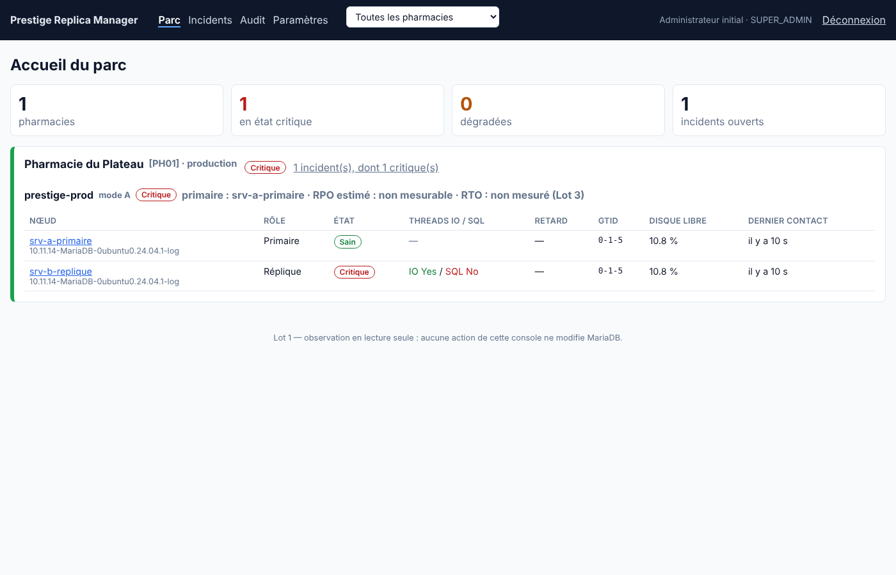

# Prestige Replica Manager

Application autonome pour **superviser, puis à terme déployer, réparer et auditer** la réplication MariaDB des bases Prestige installées dans plusieurs pharmacies.

L'application pilote les mécanismes natifs de MariaDB (binlog, GTID, `mariadb-backup`) ; elle ne réimplémente jamais la réplication. Si la console s'arrête, la réplication MariaDB continue.

> **État : Lots 1 à 4.** Observation du parc (lecture seule) ; sauvegardes `mariadb-backup` chiffrées et vérifiées par restauration ; construction assistée d'une réplique ; pause/reprise, réparation guidée et bascule planifiée sans perte avec double approbation et rapport d'opération ; routeur de connexion (adresse fixe pour Prestige), bascule d'urgence assistée avec isolement persistant de l'ancien primaire, exercices de panne programmables, procédure sans console ; archivage continu et chiffré des journaux binaires, explorateur des journaux (qui a modifié quoi, quand, valeurs avant/après) et restauration à un instant précis ou juste avant une transaction, dans une instance isolée ; contrôles de cohérence primaire/réplique (schéma et données), planifiés ou à la demande. Détails : [lot 1](docs/perimetre-lot1.md), [lot 2](docs/perimetre-lot2.md), [lot 3](docs/perimetre-lot3.md), [lot 4](docs/perimetre-lot4.md), [restauration à un instant](docs/perimetre-restauration-instant.md), [cohérence](docs/perimetre-coherence.md). En cas de panne : [procédure d'urgence](docs/procedure-urgence.md).



## Composants

| Dossier | Rôle | Technologie |
|---|---|---|
| `agent/` | Agent installé près de chaque MariaDB : collecte l'état (threads IO/SQL, retard, GTID, binlogs, configuration, disque) et l'envoie au Control Plane. Liste blanche fermée d'instructions `SHOW`, aucun port ouvert, file bornée hors connexion, CLI de secours `prm-agent status`. | Go, binaire unique Linux/Windows |
| `agent/internal/ops` | Lot 2 : opérations en liste fermée exécutées par l'agent (prérequis, sauvegarde, restauration de contrôle, construction de réplique, purge), chacune activable localement. | Go |
| `agent/internal/router` | Lot 4 : routeur de connexion TCP vers le seul serveur accessible en écriture ; refuse en cas de doute (`prm-agent router`). | Go |
| `control-plane/` | API REST, inventaire multi-pharmacies, règles d'alerte, incidents, notifications courriel/webhook, audit append-only chaîné, sondes `/health/*`. | Java 21, Quarkus, PostgreSQL, Flyway |
| `web/` | Console : parc, fiche nœud, incidents, audit, paramètres. Pharmacie active rappelée en permanence. | Vue 3, TypeScript strict, Vite, Pinia |
| `deploy/` | Unités `systemd`, installation du service Windows, `docker compose`. | |
| `scripts/lab/` | Laboratoire local primaire → réplique GTID pour les essais. | |

## Démarrage rapide (laboratoire)

Prérequis : Go 1.24+, JDK 21, Maven, Node 22, PostgreSQL, MariaDB 10.5+.

```bash
# 1. MariaDB primaire (3307) + réplique GTID (3308)
scripts/lab/start-lab.sh

# 2. Base de métadonnées
createuser prm --pwprompt && createdb -O prm prm

# 3. Construction complète (interface intégrée au Control Plane + agents)
SKIP_TESTS=1 scripts/build-all.sh

# 4. Control Plane
export PRM_DB_PASSWORD=... PRM_SESSION_KEY=$(openssl rand -hex 24) PRM_BOOTSTRAP_ADMIN_PASSWORD='un-mot-de-passe-long'
java -jar control-plane/target/quarkus-app/quarkus-run.jar
# → http://127.0.0.1:8080 (compte « admin »)
```

Dans la console : **Paramètres** → créer l'organisation, la pharmacie, la topologie, puis enregistrer chaque serveur MariaDB. Le jeton affiché une seule fois va dans le fichier `agentTokenFile` de l'agent :

```bash
PRM_DB_PW=monitor-lab dist/prm-agent-linux-amd64 run -config agent.json
```

Installation en production : [docs/installation.md](docs/installation.md).

## Tests

```bash
cd agent && go test ./...                      # agent
cd control-plane && mvn test                   # règles d'alerte + parcours API complet (PostgreSQL requis : prm_test)
cd web && npm run build                        # vérification TypeScript stricte
```

## API

OpenAPI : `/q/openapi`. Principales routes du Lot 1 :

```text
POST /api/v1/agent/reports              rapports d'agent (jeton Bearer, mTLS optionnel)
GET  /api/v1/fleet                      état du parc par pharmacie / topologie / nœud
POST /api/v1/nodes/register             inventaire manuel d'un nœud, jeton d'agent rendu une fois
POST /api/v1/nodes/{id}/rotate-token    révocation et remplacement du jeton
GET  /api/v1/nodes/{id}  …/health  …/metrics?hours=
GET  /api/v1/incidents   POST /api/v1/incidents/{id}/acknowledge
GET  /api/v1/audit  …/export  …/verify
GET/POST /api/v1/tenants  /sites  /topologies  /users  /notification-channels
GET  /health/live  /health/ready  /health/startup   /q/metrics
```

Lot 2 :

```text
POST /api/v1/nodes/{id}/preflight                  contrôle des prérequis + my.ini recommandé
POST /api/v1/nodes/{id}/backups                    sauvegarde complète immédiate
POST /api/v1/backups/{id}/verify                   restauration de contrôle isolée
GET  /api/v1/backups?topologyId=   …/{id}/restore-tests
PUT  /api/v1/topologies/{id}/backup-policy         planification, conservation, test hebdomadaire
POST /api/v1/topologies/{id}/replicas/provision    demande de construction (ressaisie du nom de topologie)
GET  /api/v1/operations?status=active   GET /api/v1/operations/{id}
POST /api/v1/operations/{id}/approve  {confirmation: code pharmacie}   POST …/cancel
GET  /api/v1/agent/jobs   POST /api/v1/agent/jobs/{id}/start|events|finish   (côté agent)
```

Lot 3 :

```text
POST /api/v1/nodes/{id}/replication/pause   {mode: ALL|SQL, reason}
POST /api/v1/nodes/{id}/replication/resume
POST /api/v1/nodes/{id}/replication/attach         rattacher au primaire actuel (ancien primaire isolé)
GET  /api/v1/nodes/{id}/repair-plan                diagnostic et actions proposées
POST /api/v1/topologies/{id}/switchover/plan       contrôles préalables
POST /api/v1/topologies/{id}/switchover            demande de bascule (approbation requise)
```

Archivage des journaux et restauration à un instant :

```text
PUT  /api/v1/topologies/{id}/binlog-policy         activer l'archivage, serveur, intervalle
GET  /api/v1/topologies/{id}/binlogs               catalogue, couverture, trous
POST /api/v1/topologies/{id}/pitr/plan  {stopAt}   contrôles et fichiers à rejouer
POST /api/v1/topologies/{id}/pitr  {stopAt, extract[], reason, stopBefore?}
POST /api/v1/topologies/{id}/binlog-search  {from, to, databases[], tables[], types[], text, reason}
prm-agent decrypt -config agent.json -in <fichier.prmseal> -out <fichier>   (CLI)
```

Contrôles de cohérence :

```text
POST /api/v1/nodes/{id}/consistency-check  {mode: FULL|SCHEMA, startAfter?}   sur une réplique
PUT  /api/v1/topologies/{id}/consistency-policy                                planification hebdomadaire, bases, exclusions
GET  /api/v1/topologies/{id}/consistency                                       état de chaque réplique
```
