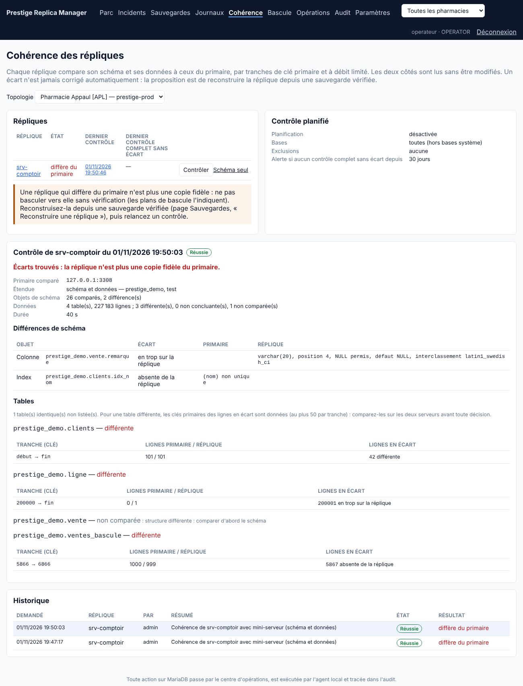
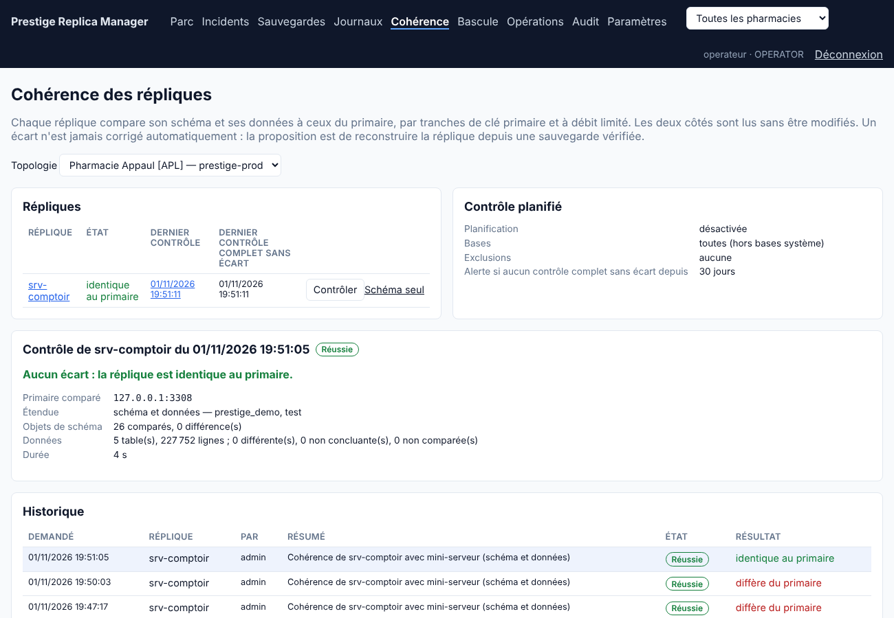

# Périmètre livré : contrôles de cohérence primaire / réplique

Une réplique dont la réplication tourne n'est pas forcément identique au primaire : une écriture faite directement sur la réplique, une erreur ignorée ou une restauration partielle suffisent à l'en écarter, sans aucune alerte. Avant de basculer vers elle, il faut le savoir. Ce contrôle compare **le schéma et les données** de chaque réplique avec ceux du primaire.

## Livré

- **Opération `CONSISTENCY_CHECK`**, exécutée par l'agent de la réplique (activable dans `agent.json` par `consistencyCheck.enabled`), avec un compte en lecture seule (`prm_check`) :
  1. **schéma** : tables, colonnes (type, ordre, nullité, défaut, interclassement), index, vues, déclencheurs, procédures et événements, comparés via `information_schema` ;
  2. **données**, table par table, par tranches de 1 000 lignes selon la clé primaire : nombre de lignes et empreinte de chaque tranche, des deux côtés ;
  3. pour une tranche différente, **recherche des lignes en écart** : clés primaires absentes de la réplique, en trop sur la réplique, ou de contenu différent (50 au plus par tranche).
- **Rien n'est jamais modifié**, ni sur le primaire ni sur la réplique. Un écart n'est pas corrigé automatiquement : la console propose de reconstruire la réplique depuis une sauvegarde vérifiée.
- **Pas de fausse alerte sur les tables actives** : chaque tranche est lue sur le primaire, puis sur la réplique une fois qu'elle a rattrapé ce point (`MASTER_GTID_WAIT`). Une tranche encore différente est relue jusqu'à 3 fois ; si le primaire l'a modifiée entre-temps à chaque fois, elle est déclarée « non concluante », pas divergente.
- **Charge limitée** : pause après chaque tranche égale au temps de lecture, durée maximale (4 h depuis la console). Un contrôle interrompu se **reprend** à la table suivante. Une table dont la structure diffère n'est pas comparée (le schéma d'abord) ; une table sans clé primaire n'est comparée que si elle a moins de 50 000 lignes.
- **Console, page Cohérence** :
  - état de chaque réplique (identique, diffère, non concluant, jamais contrôlée) et date du dernier contrôle complet sans écart ;
  - **Contrôler** ou **Schéma seul**, **Reprendre** ;
  - détail : différences de schéma, tables en écart avec leurs tranches et les clés des lignes concernées ;
  - historique.
- **Contrôle hebdomadaire** réglable : jour, heure de la pharmacie, schéma seul ou complet, bases, exclusions (`base.table`, `base.*`).
- **Alertes** :
  - « réplique divergente » (critique) tant que le dernier contrôle trouve des écarts. Elle se ferme d'elle-même après un contrôle sans écart ou une reconstruction réussie de la réplique ;
  - « contrôle en retard » (avertissement) sans contrôle complet sans écart depuis 30 jours (réglable).
- **Bascules** : le plan de bascule planifiée et celui de bascule d'urgence avertissent si la réplique visée différait du primaire au dernier contrôle. Ils ne bloquent pas : en urgence, la meilleure réplique disponible reste un choix humain.
- Tout est tracé : demande dans l'audit, journal de l'opération, résultat conservé dans l'historique.

## Vérifié

**Essai au laboratoire**, deux serveurs MariaDB 10.6, via la console. Une vente est écrite toutes les 50 ms sur le primaire pendant tout l'essai.

Cinq écarts ont été introduits à la main sur la réplique, hors réplication (`sql_log_bin=0`) :
- un solde client modifié (client 42) ;
- une vente supprimée (5867) ;
- une ligne ajoutée (200001) ;
- une colonne ajoutée (`vente.remarque`) ;
- un index supprimé (`clients.idx_nom`).

Résultats :
- Premier contrôle : 224 749 lignes en 40 s. Les cinq écarts ont été trouvés, avec la bonne clé et la bonne nature. La table `vente` n'a pas été comparée, à cause de la colonne en trop. **Aucune fausse alerte** sur la table des ventes, pourtant écrite pendant le contrôle.
- Alerte critique « srv-comptoir n'est plus une copie fidèle du primaire » ouverte. Le plan de bascule vers cette réplique affichait l'avertissement.
- Écarts corrigés à la main, puis nouveau contrôle : **aucun écart** sur 227 752 lignes en 4 s. L'alerte s'est fermée seule.

**Tests automatisés** :
- console (6 scénarios) :
  - refus sur le primaire et sur un agent non activé ;
  - droits ;
  - réglages et validation des listes ;
  - planification hebdomadaire, une fois par jour, sans doublon ;
  - alerte et avertissement de bascule ;
  - une reprise partielle sans écart n'efface pas un écart trouvé avant ;
  - retard ;
- agent : comparaison des schémas, découpage en tranches (clés composées), validation ;
- essai de bout en bout sur le laboratoire (`PRM_LAB_CHECK=1`).

## Correctif livré avec cette étape

Deux rapports simultanés d'un même agent (rattrapage après une coupure réseau) pouvaient ouvrir deux fois le même incident. Le second échouait alors (erreur 500) et l'agent le renvoyait. L'ouverture et la fermeture des incidents sont désormais sérialisées par topologie. Un test envoie 8 rapports en parallèle.

## Limites

- Le contrôle compare **l'état à un instant donné**. Il ne dit pas d'où vient un écart : pour cela, utiliser l'explorateur des journaux sur les clés signalées.
- Les tables **sans clé primaire** de plus de 50 000 lignes ne sont pas comparées. Elles sont signalées « non comparées ».
- Les **événements** ne sont comparés que si `prm_check` a le droit `EVENT` sur la base. Les **procédures** ne sont comparées que s'il peut lire leur définition (`SELECT ON mysql.proc`). Sans ces droits, ils sont absents des deux côtés et donc non comparés.
- Valeurs à virgule flottante (`FLOAT`, `DOUBLE`) : comparées sur leur texte, ce qui est fiable entre deux serveurs de même version.
- La correction reste un geste humain : reconstruction de la réplique (page Sauvegardes), ou correction ciblée après analyse.
