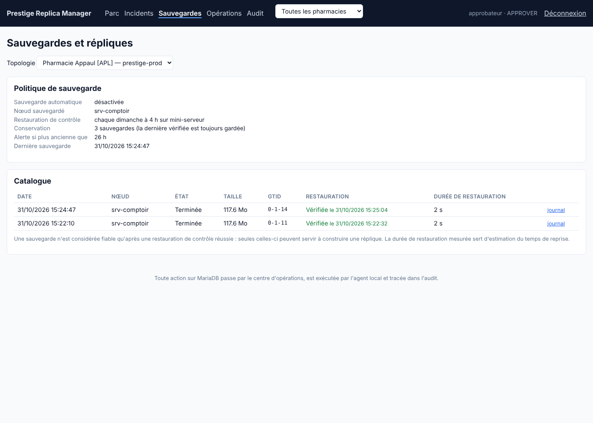

# Périmètre livré — Lot 2 « Sauvegardes et construction de réplique »

Priorité donnée à Windows et MariaDB 10.6 (réponses du 31/10/2026).

## Livré

**Principe de sûreté.** La console ne pousse jamais de SQL ni de commande : elle dépose une *opération* typée (prérequis, sauvegarde, restauration de contrôle, construction de réplique, purge). L'agent la récupère par sa connexion sortante, refuse tout type inconnu, tout paramètre inattendu, et toute capacité non activée dans son `agent.json`. Une seule opération à la fois par serveur ; chaque étape est journalisée et visible en direct.

- **Prérequis** : version, `log_bin`, `server_id`, durabilité (`sync_binlog`, `innodb_flush_log_at_trx_commit`), outils `mariadb-backup`/`mbstream`/`mariadbd`, stockage, clé, espace disque ; section `[mysqld]` recommandée prête à copier.
- **Sauvegarde complète** `mariadb-backup --stream`, chiffrée à la volée (AES-256-GCM, clé locale, jamais transmise à la console), empreinte SHA-256, manifeste signé, position GTID relevée. Planification quotidienne dans le fuseau de la pharmacie, conservation des N dernières (la dernière vérifiée n'est jamais purgée).
- **Restauration de contrôle** : déchiffrement, extraction, `--prepare`, démarrage d'une instance MariaDB isolée (127.0.0.1, port aléatoire, sans réseau), comptages sur les plus grosses tables, mesure de la durée de restauration (estimation du RTO). Hebdomadaire automatique. Une sauvegarde altérée est refusée.
- **Construction d'une réplique** : uniquement depuis une sauvegarde **vérifiée** et portant une position GTID ; demande avec ressaisie du nom de la topologie ; approbation par une **autre personne** (rôle Approbateur) avec ressaisie du code de la pharmacie ; l'agent refuse si le serveur a des répliques connectées (il ressemble à un primaire) ou si le dossier confirmé diffère de sa configuration. Arrêt du service, échange du dossier de données (l'ancien est conservé), redémarrage, `read_only`, GTID, `CHANGE MASTER … MASTER_USE_GTID=slave_pos`, attente du rattrapage. Retour arrière automatique si MariaDB ne redémarre pas ; état « Intervention requise » + incident critique sinon. Réplique différée possible (`MASTER_DELAY`).
- **Alertes** : sauvegarde absente ou trop ancienne, sauvegarde échouée, restauration échouée, aucune restauration vérifiée depuis 8 jours, opération en intervention requise.
- **Console** : écrans *Sauvegardes* (politique, catalogue, assistant de réplique) et *Opérations* (file, journal en direct, approbation, annulation) ; boutons *Vérifier les prérequis* / *Sauvegarder maintenant* sur la fiche serveur.
- **CLI de secours** : `prm-agent keygen | preflight | backup | restore-test`, utilisables sans console.

## Vérifié

Sur MariaDB réelle (laboratoire primaire 3307 → réplique 3308), entièrement depuis la console :

| Étape | Résultat |
|---|---|
| Prérequis de la réplique | prêt, 1 avertissement de durabilité (`sync_binlog=0`) |
| Sauvegarde du primaire | 117 Mo chiffrés en 6 s, GTID `0-1-14` |
| Restauration de contrôle sur la réplique | vérifiée en 2 s, 200 000 lignes comptées |
| Auto-approbation / mauvais code de pharmacie | refusés (403 / 400), refus tracés dans l'audit |
| Construction de la réplique | réussie en 12 s ; lignes écrites après la sauvegarde **et pendant** la reconstruction présentes sur la réplique ; `read_only=ON`, `Using_Gtid=Slave_Pos`, retard 0 s |
| Droit `RELOAD` manquant (1er essai) | arrêt propre en « Intervention requise », incident critique, puis incident fermé automatiquement après la reconstruction réussie |

Tests automatisés : 23 côté Control Plane (dont le cycle complet d'opérations, les règles d'approbation et l'isolement entre organisations), tests unitaires de l'agent (chiffrement, chemins, liste blanche, manifeste).

## Écarts assumés et reste à faire

- Sauvegardes **complètes** uniquement (pas d'incrémentales ni de copie hors site automatique) : à décider selon la taille réelle (≈ 21 Go aujourd'hui).
- Sous Windows, la restauration de contrôle et la construction n'ont pas encore été exécutées sur une vraie machine Windows : le code gère `net stop/start`, les chemins `C:\Program Files\MariaDB 10.6\bin` et l'absence de `--user`, mais un essai sur un poste de test est recommandé avant la première pharmacie.
- La version de `mariadb-backup` doit correspondre à celle du serveur (10.6.18 ↔ 10.6.x) : vérifiée par les prérequis.
- Pause/reprise, reconstruction guidée après incident et bascule (switchover) : Lot 3.

## À confirmer de votre côté

- Activer `log_bin` sur le serveur de production (redémarrage MariaDB requis) — procédure : [installation.md §5.1](installation.md#51-activer-le-journal-binaire-préalable-à-toute-réplication).
- Débit d'écriture : `SHOW GLOBAL STATUS LIKE 'Innodb_os_log_written';` à deux moments espacés d'une heure aux heures de pointe (la différence donne les octets écrits par heure).
