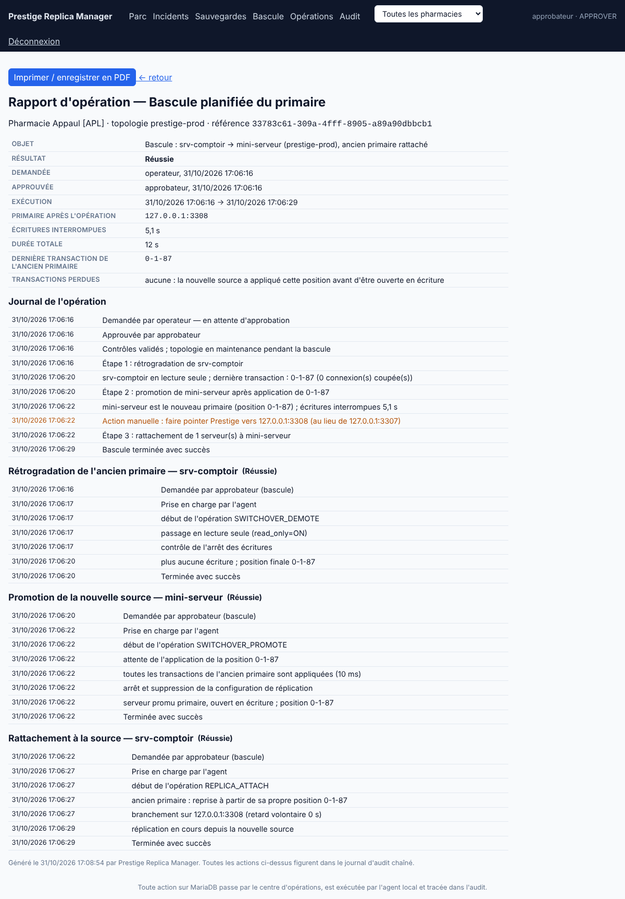

# Périmètre livré — Lot 3 « Opérations contrôlées »

Basculement **manuel, assisté** (réponse 7 du 31/10/2026) : aucune action automatique, chaque bascule est demandée, approuvée par une seconde personne et tracée.

## Livré

- **Pause / reprise** d'une réplique (toute la réplication, ou seulement l'application des transactions pour que les journaux continuent d'arriver), avec motif obligatoire. Pendant la pause, les alertes « thread arrêté » et « retard » sont remplacées par un rappel unique « Réplication suspendue par X : motif ». Si quelqu'un relance la réplication hors console, la pause est levée automatiquement.
- **Réparation guidée** : diagnostic de la réplique et actions proposées selon la cause : reprise, attente (erreur réseau), ou reconstruction depuis une sauvegarde vérifiée. Le saut d'erreur (`sql_slave_skip_counter`) n'est **jamais** proposé : il rendrait la réplique divergente sans que personne le sache. La reconstruction refuse désormais une sauvegarde plus ancienne que la rétention des binlogs du primaire.
- **Bascule planifiée** (switchover), orchestrée par la console :
  1. contrôles préalables : rapports récents, réplique saine et à jour (≤ 10 s), GTID, binlog actif sur la cible, `server_id` distincts, versions, aucune autre opération en cours, autorisation locale sur chaque agent ;
  2. demande avec ressaisie du nom de la topologie, approbation par une autre personne avec ressaisie du code de la pharmacie, et nouveaux contrôles au moment de l'exécution ;
  3. rétrogradation de l'ancien primaire : `read_only`, coupure des connexions applicatives, puis constat que la position GTID ne bouge plus. Si les écritures continuent (compte applicatif avec `SUPER`), la bascule est annulée ;
  4. promotion de la cible seulement après `MASTER_GTID_WAIT` sur la dernière transaction de l'ancien primaire : **aucune transaction confirmée n'est perdue**. Si la position n'est pas atteinte, rien n'est modifié et l'ancien primaire est rouvert en écriture automatiquement ;
  5. rattachement des autres répliques (le retard volontaire d'une réplique différée est conservé) et, au choix, de l'ancien primaire. Sinon, l'ancien primaire reste isolé en lecture seule jusqu'à validation, avec un bouton « Rattacher au primaire » ;
  6. inventaire mis à jour (rôles échangés), topologie en maintenance pendant la bascule pour éviter les fausses alertes, consultation des opérations accélérée à 1 s pour les agents concernés.
- **Rapports d'opération** imprimables (PDF via le navigateur) : demande, approbation, chaque étape et son journal, durée d'interruption des écritures, positions GTID, rappel de l'action manuelle (pointer Prestige vers le nouveau primaire).

## Vérifié

Laboratoire MariaDB primaire ↔ réplique, avec un simulateur de Prestige qui enregistre une vente toutes les 50 ms (une connexion par vente) et note chaque vente confirmée :

| Essai | Résultat |
|---|---|
| Bascule A → B (agents à 30 s d'intervalle de rapport) | réussie en 9 s, écritures interrompues 4,1 s, **0 vente confirmée perdue** sur 133 |
| Bascule retour B → A (contrôle d'arrêt des écritures à 1 s) | réussie en 5 s, écritures interrompues **2,1 s**, **0 vente perdue** sur 115 ; ancien primaire rattaché et répliquant |
| Pause « application seulement » puis reprise | rappel « Réplication suspendue par operateur : motif » à la place des alertes critiques, levé à la reprise |
| Promotion impossible (simulée) | retour arrière automatique, ancien primaire rouvert, rôles inchangés |

Tests automatisés : 29 côté Control Plane (dont 6 pour ce lot : refus des cibles inadaptées, retour arrière, bascule complète avec rattachements, pause, plan de réparation), tests de l'agent (opt-in local obligatoire, paramètres inattendus refusés).

## Limites et suite

- **La redirection de Prestige reste manuelle** : la console indique la nouvelle adresse. Une adresse stable (DNS interne, IP virtuelle ou proxy MaxScale) supprimerait cette étape : c'est le premier point du Lot 4.
- Les ventes tentées pendant l'interruption (2 à 4 s) échouent côté Prestige ; elles ne sont pas perdues silencieusement, l'application doit les rejouer ou afficher une erreur.
- Bascule d'urgence (primaire injoignable), fencing et failover automatique : Lot 4, sur décision explicite.
- Toujours pas d'essai sur une vraie machine Windows.
