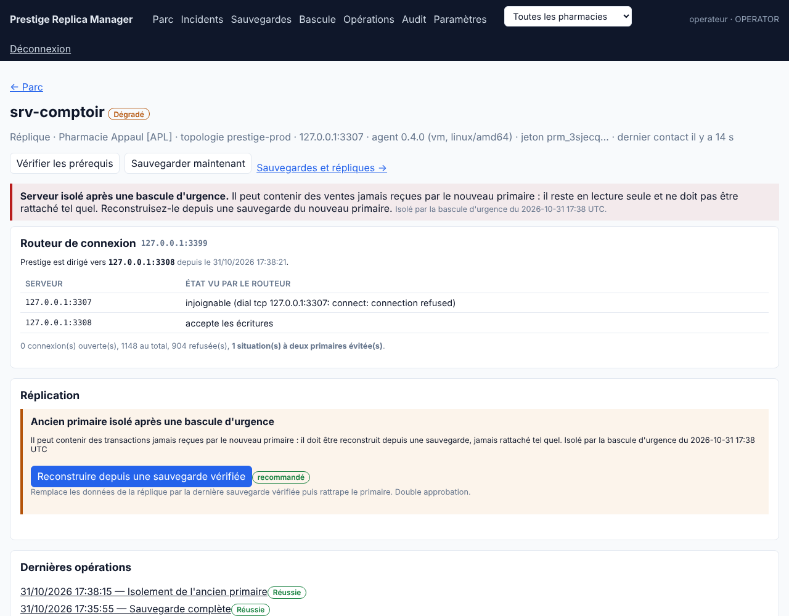
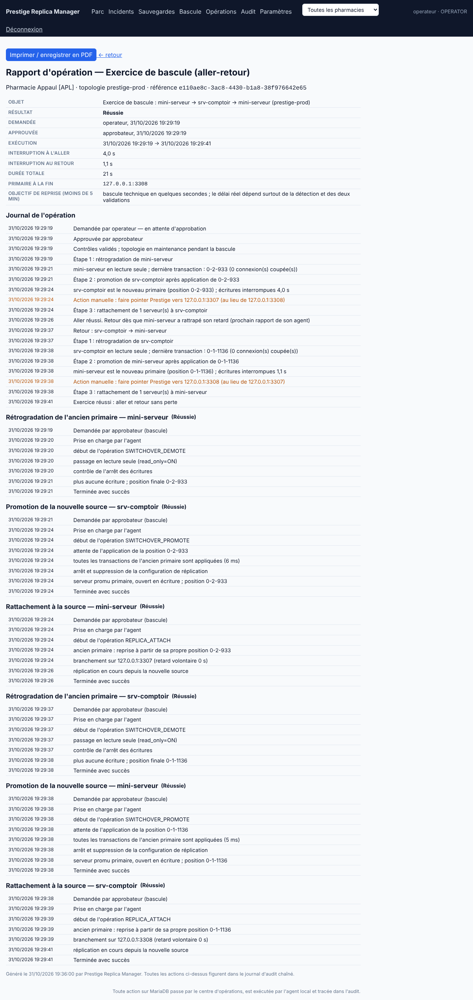

# Périmètre livré — Lot 4 « Haute disponibilité »

Conformément à la réponse 7 du 31/10/2026, la bascule reste **manuelle et assistée** : rien n'est déclenché automatiquement. Le Lot 4 rend la bascule d'urgence sûre et rapide, et supprime la reconfiguration de Prestige après une bascule.

## Livré

- **Routeur de connexion** (`prm-agent router`, ou section `router` de l'agent) : adresse fixe pour Prestige. Il dirige chaque nouvelle connexion vers le seul serveur accessible en écriture et qui ne réplique pas, et refuse les connexions s'il y en a zéro ou plusieurs. Il coupe les connexions restées ouvertes vers un ancien primaire. Une sonde manquée isolée est tolérée. Son état est visible sur la fiche du serveur qui l'héberge. Installation sur chaque poste Prestige (sans point unique de panne) ou sur un serveur d'accès. Voir installation §7.
- **Isolement (fencing)** d'un ancien primaire par son agent : lecture seule et coupure des connexions si MariaDB répond ; sinon arrêt du service et passage du démarrage en manuel, pour qu'un redémarrage de la machine ne le remette pas en service. Script `grant-service-control.ps1` pour donner ces droits au compte de l'agent.
- **Bascule d'urgence assistée** (Bascule → onglet Urgence) :
  1. refusée tant que le primaire répond : il faut alors utiliser la bascule planifiée, sans perte ;
  2. choix automatique de la réplique ayant **reçu** le plus de transactions, avec avertissement si l'on en choisit une autre ;
  3. **perte estimée** avant validation, en comparant la dernière position connue du primaire à ce que la réplique a reçu ;
  4. si l'agent de l'ancien primaire répond, isolement par l'agent avant toute promotion. Sinon, la personne doit confirmer que la machine est éteinte ou débranchée. Si l'isolement échoue sans cette confirmation, rien n'est modifié ;
  5. double validation (comme la bascule planifiée), promotion après application de tout ce qui a été reçu, rattachement des autres répliques, inventaire mis à jour ;
  6. l'ancien primaire est marqué **isolé** : incident unique, rattachement refusé, seule la reconstruction depuis une sauvegarde est proposée. Une reconstruction réussie lève l'isolement.
- **Garde-fou permanent** : si un serveur isolé redevient accessible en écriture (redémarrage manuel, par exemple), la console le remet en lecture seule dès le rapport suivant de son agent et ouvre un incident critique. Entre-temps, le routeur refuse les connexions.
- **Procédure sans console** : `prm-agent fence` et `prm-agent promote` sur les serveurs, `prm-agent status` affiche `Gtid_IO_Pos` pour choisir la réplique la plus avancée. Au retour de la console, un administrateur déclare la bascule faite à la main, ce qui aligne l'inventaire et isole l'ancien primaire. Fiche imprimable : [procedure-urgence.md](procedure-urgence.md).
- Rapport d'opération imprimable pour la bascule d'urgence (perte estimée, durée sans primaire, étapes).
- **Isolement persistant côté agent** : l'agent d'un serveur isolé garde un marqueur local et le remet en lecture seule dans les 2 secondes s'il redevient accessible en écriture (redémarrage après une coupure de courant, relance manuelle), **même si la console est injoignable**. Une reconstruction réussie lève le marqueur ; `prm-agent unfence` le lève à la main, et `prm-agent status` affiche « ISOLÉ ».
- **Exercices de panne** (Bascule → onglet Exercice) : bascule planifiée vers une réplique puis retour automatique sur le primaire habituel dès qu'il a rattrapé son retard (au plus 10 minutes d'attente, sinon arrêt sans perte et intervention demandée). L'exercice peut être **programmé** à une heure creuse, avec double validation comme une bascule. Le bilan donne l'interruption à l'aller et au retour. Un **rappel** (incident « aucun exercice réussi depuis N jours », 90 par défaut, réglable ou désactivable par topologie) maintient la procédure éprouvée ; une vraie bascule planifiée réussie compte comme exercice.

## Vérifié

Laboratoire MariaDB à deux serveurs, agents à 30 s d'intervalle de rapport, Prestige simulé par une vente toutes les 50 ms **à travers le routeur**, chaque vente confirmée étant notée :

| Essai | Résultat |
|---|---|
| Arrêt brutal (`kill -9`) du primaire srv-comptoir, bascule d'urgence vers mini-serveur | panne visible dans la console en 15 s ; bascule terminée 21 s après la panne (5,6 s entre l'approbation et la promotion) ; **119 ventes confirmées sur 119** présentes sur le nouveau primaire ; 341 tentatives refusées par le routeur pendant la panne, aucune envoyée au mauvais serveur |
| Même essai dans l'autre sens | bascule terminée 35 s après la panne, isolement puis promotion réussis |
| Ancien primaire relancé à la main puis mis en écriture | routeur : « plusieurs serveurs acceptent les écritures », connexions refusées 18 s ; console : remise en lecture seule automatique 21 s après |
| Reconstruction de l'ancien primaire depuis une sauvegarde vérifiée | isolement levé, réplication repartie (IO/SQL Yes, retard 0) |
| Serveur isolé relancé puis mis en écriture à la main, console comprise | remis en lecture seule par son agent en **0,2 s** |
| Exercice aller-retour avec ventes simulées à travers le routeur | réussi en 21 s ; interruption 4,0 s à l'aller et 1,1 s au retour ; **387 ventes confirmées sur 387** présentes |
| Tests automatisés | 7 scénarios (contrôles, choix de la réplique, perte estimée, échec d'isolement sans effet, bascule complète, remise en lecture seule automatique, déclaration d'une bascule manuelle) ; tests du routeur (routage, refus pendant la bascule, coupure des anciennes connexions, deux primaires, sonde manquée) |

Dans ces essais, les approbations sont scriptées. En réel, le temps de rétablissement est surtout celui des deux personnes : détection (≤ 30 s plus la notification), demande et approbation. L'objectif de moins de 5 minutes reste atteignable si un approbateur est joignable.

## Hors périmètre / limites

- **Pas de bascule automatique**, par choix (réponse 7). Le routeur ne promeut jamais rien : il suit seulement le serveur que la console ou une personne a promu.
- Réplication **asynchrone** : les ventes écrites dans les dernières secondes avant une panne brutale peuvent ne pas avoir été reçues. La perte est estimée, pas évitée. Pour la réduire à zéro, il faudrait la réplication semi-synchrone, qui ralentit chaque vente : à décider avec vous.
- Lors d'un changement de serveur, les transactions en cours sur les connexions coupées sont annulées par MariaDB ; Prestige doit les rejouer (comme après une coupure réseau).
- **Exercice de panne brutale** : l'exercice livré est une bascule planifiée aller-retour (sans perte). Simuler une panne brutale en production n'est pas proposé ; la procédure d'urgence est éprouvée au laboratoire et par les tests automatisés.
- **Multi-site** : une topologie peut déjà mélanger répliques locales, distantes et cloud, et la bascule (planifiée ou d'urgence) fonctionne vers chacune. Il n'y a pas d'orchestration au niveau de plusieurs pharmacies à la fois (par exemple reprise de toutes les pharmacies d'une région sur le cloud).
- Après une coupure de courant générale, si `read_only=ON` figure dans le `my.ini` du primaire, il redémarre en lecture seule : un administrateur doit le rouvrir (le routeur refuse les connexions en attendant). Recommandation : `read_only=ON` dans le `my.ini` des **répliques seulement**.
