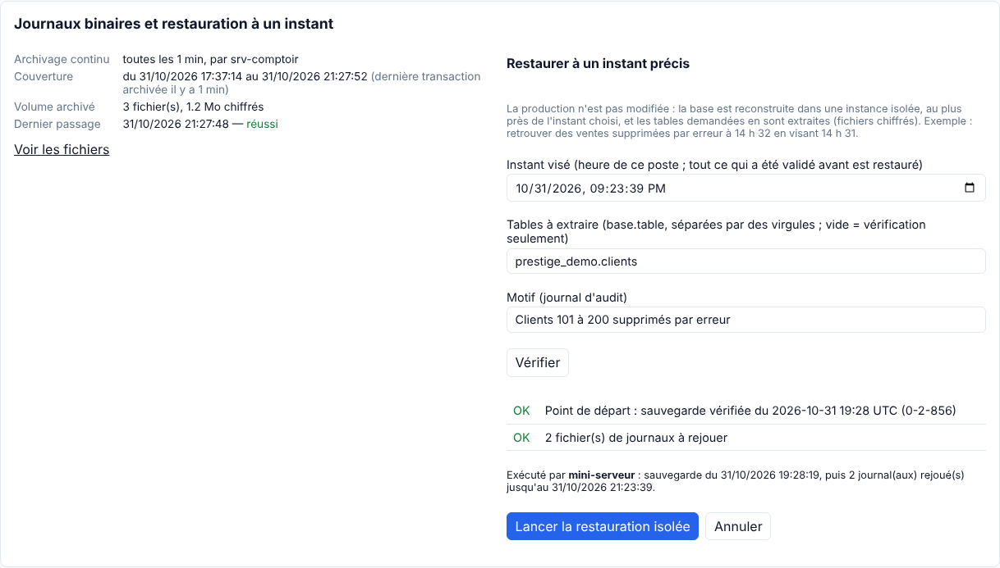
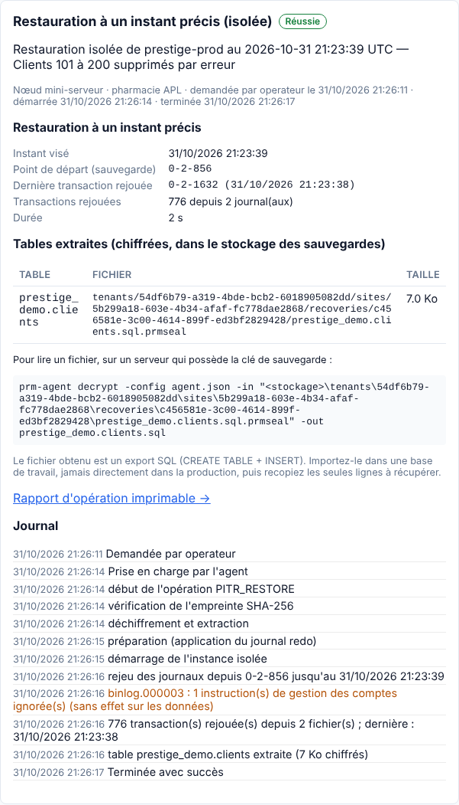
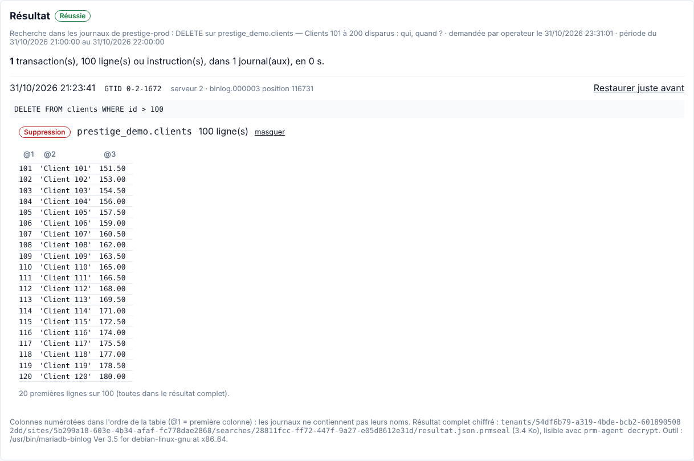
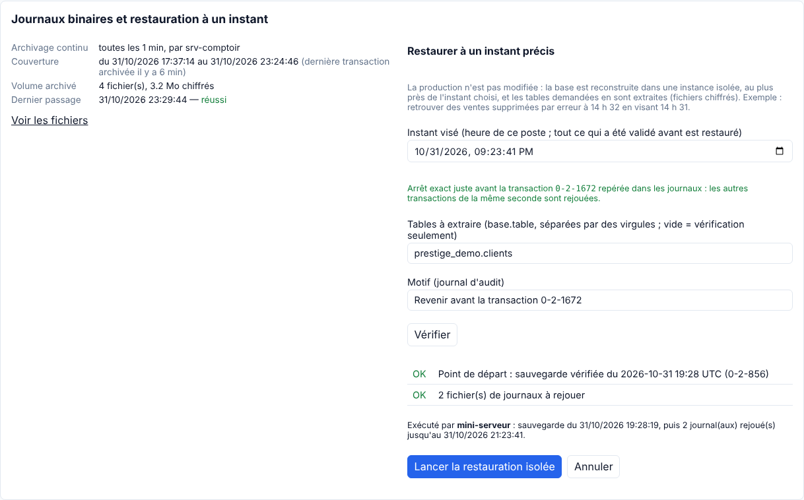

# Périmètre livré : archivage des journaux, explorateur et restauration à un instant précis

La sauvegarde quotidienne permet de revenir à l'état de la nuit. Cette étape permet de revenir **à la seconde près**, par exemple juste avant une suppression accidentelle, sans jamais toucher la production.

## Livré

- **Archivage continu des journaux binaires** (opération `BINLOG_ARCHIVE`, activable dans `agent.json` par `binlogArchive.enabled`) :
  - l'agent du serveur de sauvegarde lit les binlogs du primaire comme une réplique (compte `prm_repl`), toutes les N minutes (5 par défaut, réglable de 1 à 60) ;
  - il les chiffre (même clé que les sauvegardes) et les range sous `backup.root`. Le fichier en cours d'écriture est recopié à chaque passage, ce qui borne la perte à l'intervalle choisi ;
  - le serveur MariaDB lu est contrôlé (`server_id`) ;
  - l'archivage suit le primaire après une bascule ;
  - les journaux antérieurs à la plus ancienne sauvegarde conservée sont supprimés automatiquement.
- **Catalogue dans la console** (page Sauvegardes) : couverture (de quand à quand), fraîcheur, volume, dernier passage, liste des fichiers avec leurs positions GTID.
- **Alertes** :
  - « archivage en retard » (avertissement) au-delà de 3 intervalles, et au moins 15 min ;
  - « trou dans l'archive » (critique) si le primaire a purgé un journal avant son archivage. L'alerte reste ouverte jusqu'à la sauvegarde complète suivante.
- **Restauration à un instant précis** (opération `PITR_RESTORE`), sur le serveur de restauration de contrôle :
  1. contrôles préalables : sauvegarde **vérifiée** antérieure à l'instant visé, archive couvrant cet instant, serveur d'exécution disponible ;
  2. restauration de la sauvegarde dans une instance isolée (comme la restauration de contrôle) ;
  3. rejeu des journaux depuis la position GTID de la sauvegarde jusqu'à l'instant visé (exclu). Les transactions déjà présentes dans la sauvegarde ne sont pas rejouées, y compris après une bascule ;
  4. contrôle (bases, tables, nombre de lignes) puis **extraction chiffrée** des tables demandées (export SQL) ;
  5. rapport : dernière transaction rejouée et son heure, nombre de transactions, transactions éventuellement absentes de l'archive.
- `prm-agent decrypt` pour lire une extraction (ou un journal archivé) sur un serveur qui possède la clé.
- Toute demande est tracée dans l'audit avec son motif. Les archivages automatiques réussis n'encombrent ni l'audit ni la liste des opérations : ils restent visibles sur la page Sauvegardes et sont purgés de l'historique après 7 jours.

## Explorateur des journaux (page Journaux)

Pour savoir **quoi** restaurer, il faut d'abord savoir **ce qui s'est passé et quand**. La page Journaux cherche dans l'archive (opération `BINLOG_SEARCH`, exécutée par l'agent du serveur d'archivage, sans solliciter la production) :

- **Filtres** : période (31 jours au plus), opérations (ajout, modification, suppression, structure), tables, bases, et une valeur recherchée dans les lignes (numéro de ticket, nom, code produit…). Le motif est obligatoire et figure dans l'audit.
- **Résultat par transaction** :
  - heure, GTID, serveur d'origine, fichier et position ;
  - **requête d'origine** quand MariaDB l'a notée (`binlog_annotate_row_events`, actif par défaut) ;
  - tables touchées et nombre de lignes ;
  - **valeurs avant et après** (20 premières lignes par changement ; toutes dans le résultat complet).
- **« Restaurer juste avant »** prépare la restauration isolée qui s'arrête **exactement avant cette transaction**, et pas seulement à la seconde. Les autres ventes de la même seconde sont donc conservées. La table touchée est déjà proposée à l'extraction.
- **Protection des données** :
  - les valeurs ne sont visibles que des rôles Opérateur, Administrateur et Auditeur ; les autres voient la date, la nature et la table, sans valeurs ;
  - la liste des opérations n'affiche jamais de valeurs ;
  - l'aperçu est effacé de la console après 30 jours ;
  - le résultat complet est chiffré dans le stockage de la pharmacie, avec un manifeste : empreintes des journaux lus, version de `mariadb-binlog`, filtres, nombre de résultats.
- Le décodage est fait par l'outil officiel `mariadb-binlog --base64-output=DECODE-ROWS --verbose`, dont la sortie est lue par l'agent. C'est une vue d'audit : la restauration passe toujours par la restauration isolée.

## Vérifié

**Essai au laboratoire** : deux serveurs MariaDB, des ventes simulées toutes les 50 ms et une table de 200 clients.

- Le scénario :
  1. mise à jour de 50 soldes ;
  2. à 21:23:39, suppression accidentelle des clients 101 à 200 ;
  3. nouvelles écritures ensuite.
- Restauration demandée par l'opérateur pour 21:23:39, en partant de la sauvegarde vérifiée de 19:28 (0-2-856) :
  - 776 transactions rejouées depuis 2 journaux en 2 s ;
  - dernière transaction rejouée à 21:23:38.
- La table extraite et déchiffrée contient exactement :
  - les **200 clients**, avec les 50 soldes mis à jour (total 30 650,00, conforme) ;
  - **1 138 ventes**, le même nombre que les ventes de la production antérieures à 21:23:39.
- **Explorateur** : la recherche « suppressions sur prestige_demo.clients entre 21 h et 22 h » parcourt 62 697 événements en moins d'une seconde. Elle renvoie une seule transaction : 21:23:41, GTID 0-2-1672, requête `DELETE FROM clients WHERE id > 100`, 100 lignes, avec les valeurs supprimées.
- **« Restaurer juste avant »** à partir de ce résultat :
  - arrêt sur la transaction 0-2-1671 ;
  - **200 clients** sur 200 ;
  - **1 177 ventes**, soit exactement celles de la production jusqu'à la dernière vente enregistrée avant la suppression (n° 2043), y compris celles de la même seconde.
  - Avec un arrêt à la seconde (21:23:41), ces ventes auraient été exclues.
- Une instruction `GRANT` présente dans les journaux a été ignorée et signalée. L'instance isolée n'a pas de comptes, et ces instructions sont sans effet sur les données. Toute autre erreur fait échouer la restauration.

**Tests automatisés** (7 scénarios), dont recherche et masquage par rôle, et arrêt avant une transaction :
- planification et intervalle, catalogue ;
- fichiers déjà archivés, alerte de retard ;
- choix de la sauvegarde et des journaux, refus d'un instant futur, avertissement au-delà de l'archive ;
- validation des tables et du motif ;
- suppression des journaux expirés, trou dans l'archive.

Tests de l'agent : contrôles d'activation, tri des erreurs de rejeu.

## Limites

- La restauration est **isolée** : la réinjection en production des lignes retrouvées reste un geste humain (import dans une base de travail, puis copie des lignes). C'est voulu.
- Précision d'une restauration demandée par une heure : la seconde ; les transactions validées pendant la seconde visée ne sont pas rejouées. Pour être exact, partir de la transaction repérée dans l'explorateur.
- Les journaux ne contiennent pas les noms des colonnes : l'explorateur les numérote (@1, @2…) dans l'ordre de la table. Une recherche de valeur porte sur le texte affiché par `mariadb-binlog`.
- Le résultat complet chiffré d'une recherche reste dans le stockage de la pharmacie : sa suppression n'est pas encore automatique.
- Après une **bascule d'urgence avec perte**, les numéros de transaction perdus peuvent être réutilisés par le nouveau primaire. Une restauration qui traverse cette bascule peut alors ignorer quelques transactions du nouveau primaire, et le rapport le signale comme un trou. Après une bascule d'urgence, lancer une sauvegarde complète : les restaurations ultérieures partiront d'elle.
- Le serveur d'archivage doit joindre le primaire sur le port MariaDB. Si le primaire et l'archive sont perdus ensemble (même machine), la perte peut aller jusqu'à un intervalle d'archivage.
- Volume : prévoir sur `backup.root` la taille des binlogs produits entre deux sauvegardes conservées (souvent quelques centaines de Mo par jour pour une pharmacie, à mesurer avec la console : **Volume archivé**).
